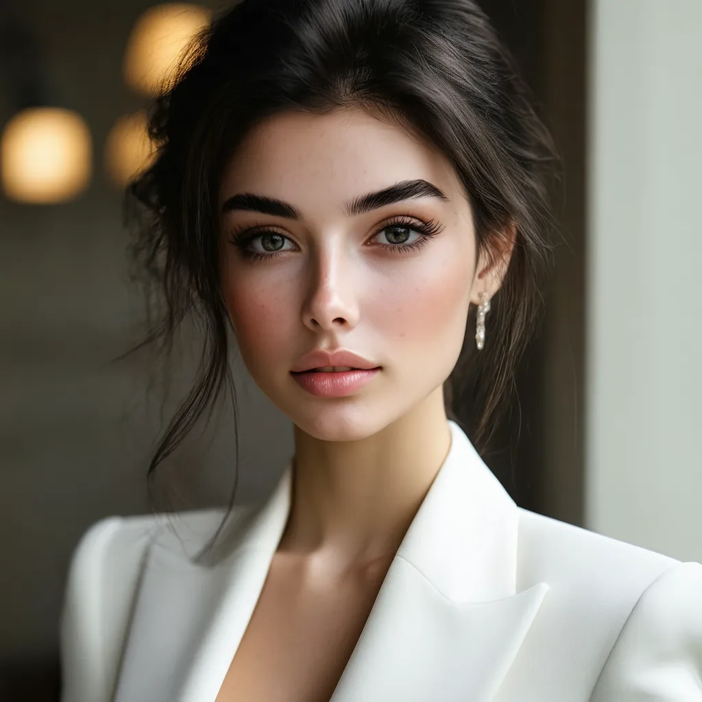
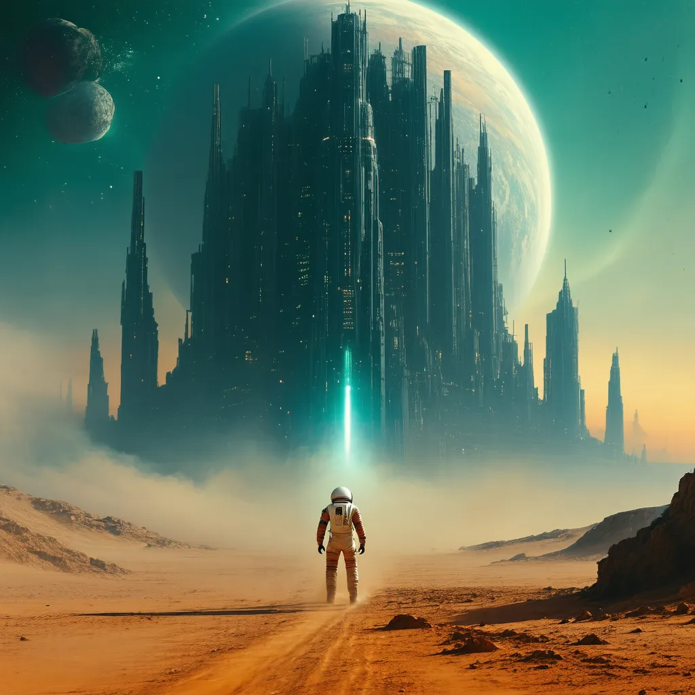

#Task 1:Advanced Prompt Engineering for Visuals

# Advanced Prompt Engineering for Visuals Using Stable Diffusion

## 1. Project Overview

This project demonstrates advanced prompt engineering techniques for AI-based image generation using **Stable Diffusion 3.5 Large (8B)**.

The project focuses on generating two different visual outputs:
1. An ultra-realistic DSLR-style portrait.
2. A cinematic promotional poster for a fictional science-fiction thriller.

Detailed prompts are designed using descriptions of subjects, camera settings, lighting, textures, colors, and composition to guide the image-generation process.

## 2. Objectives

- Understand the fundamentals of prompt engineering.
- Generate photorealistic images using descriptive prompts.
- Create a cinematic promotional poster.
- Explore the role of positive and negative prompts, where supported.
- Evaluate generated images based on visual quality and composition.
- Document prompts, outputs, and observations using GitHub.

## 3. Technology Stack

- **AI Model:** Stable Diffusion 3.5 Large (8B), if this is the model used for generation.
- **Model Reference:** [Stable Diffusion 3.5 Large](https://huggingface.co/stabilityai/stable-diffusion-3.5-large)
- **Image Generation:** The browser-based image-generation interface used for the experiments.
- **Prompt Documentation:** Markdown
- **Version Control and Submission:** GitHub

## 4. Task 1: Ultra-Realistic DSLR Portrait

### Objective

Generate a professional portrait with realistic facial features, natural skin texture, photographic lighting, and a softly blurred background.

### Prompt Engineering Techniques

- Subject description: Specified the subject's appearance, hair, and clothing.
- Camera terminology: Used an 85mm lens, f/1.8 aperture, and shallow depth of field.
- Lighting: Described soft diffused window lighting and natural shadows.
- Texture: Emphasized skin pores, detailed eyes, and realistic fabric.
- Composition: Specified a head-and-shoulders portrait and eye-level camera angle.

### Generated Image



**Prompt file:** [`prompts/portrait_prompt.md`](prompts/portrait_prompt.md)

## 5. Task 2: Cinematic Promotional Poster

### Objective

Create a cinematic promotional poster for a fictional science-fiction thriller titled *THE LAST HORIZON*.

### Prompt Engineering Techniques

- Subject and environment: Described an astronaut, an alien desert, a futuristic city, and an eclipsed planet.
- Composition: Used a low-angle perspective and a strong foreground silhouette.
- Lighting: Combined dramatic orange sunset lighting with deep teal shadows.
- Atmospheric effects: Included fog, floating dust particles, and volumetric light rays.
- Color grading: Specified rich contrast, deep blacks, and cinematic colors.
- Layout: Requested clear space for the title and credits.

### Generated Image



**Prompt file:** [`prompts/poster_prompt.md`](prompts/poster_prompt.md)

## 6. Experiments and Observations

Two prompt engineering experiments were planned and documented.

| Experiment | Visual Output | Main Evaluation Criteria |
|---|---|---|
| 1 | DSLR Portrait | Skin texture, eye detail, lighting, background blur |
| 2 | Cinematic Poster | Composition, atmosphere, lighting contrast, environmental details |

The portrait prompt emphasizes photographic realism, while the poster prompt focuses on cinematic composition and environmental storytelling.

Detailed experiment notes are available in [`experiments.md`](experiments.md).

*Final observations should be updated based on the actual generated images.*

## 7. Project Structure

```text
advanced-prompt-engineering-visuals/
├── images/
│   ├── dslr_portrait.png
│   └── cinematic_poster.png
├── prompts/
│   ├── portrait_prompt.md
│   └── poster_prompt.md
├── experiments.md
└── README.md
```

## 8. Results

The project aims to produce two distinct AI-generated visuals:

1. A realistic portrait using detailed photographic descriptions.
2. A cinematic science-fiction poster using atmospheric and composition-focused descriptions.

These tasks demonstrate how prompt specificity can guide image generation toward different visual styles.

## 9. Conclusion

This project explores the use of advanced prompt engineering for generating different types of visual content. By describing the subject, lighting, textures, camera perspective, colors, and composition in detail, prompts communicate the intended appearance of the final image.

The generated images, prompt files, and experiment notes are organized in a GitHub repository to support documentation, review, and submission.

## 10. References

- [Stable Diffusion 3.5 Large — Hugging Face](https://huggingface.co/stabilityai/stable-diffusion-3.5-large)
- [Hugging Face Diffusers Documentation](https://huggingface.co/docs/diffusers)
- [Stable Diffusion Web UI](https://github.com/AUTOMATIC1111/stable-diffusion-webui)

---

**Reproducibility note:** Record the actual model version, generation interface, image dimensions, and any settings used. Do not claim a specific model was used unless the image-generation interface confirms it.
